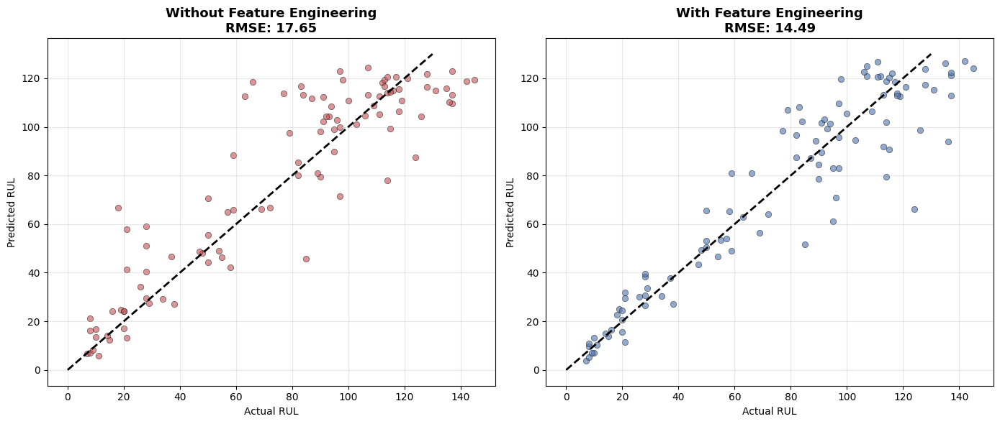
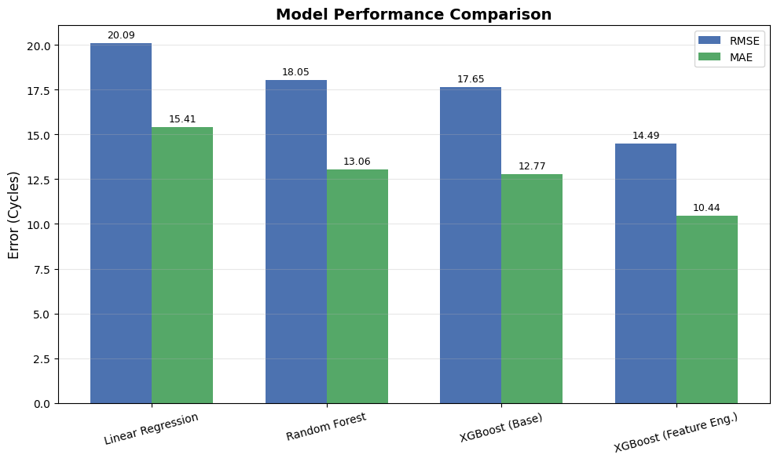
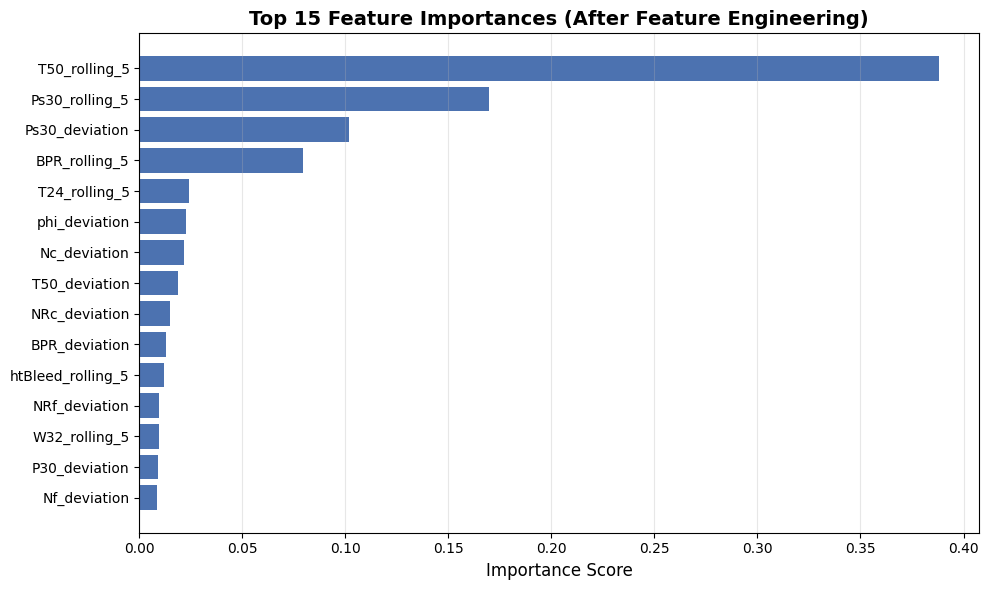
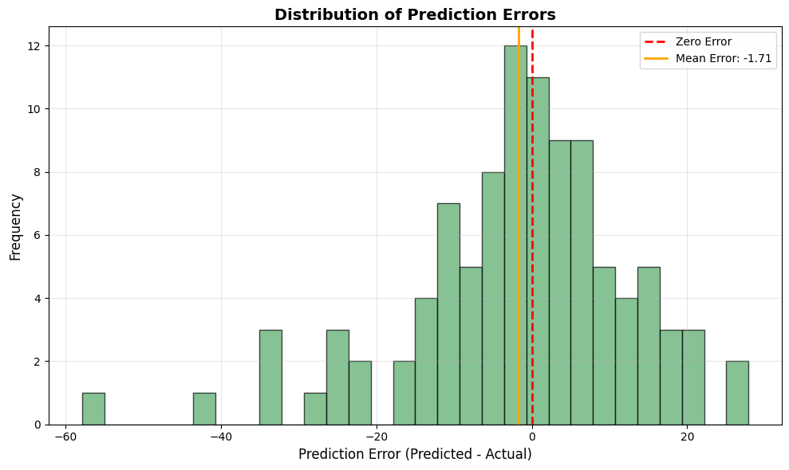

# NASA C-MAPSS: Remaining Useful Life (RUL) Prediction

Predicting the Remaining Useful Life of aircraft turbofan engines using the NASA C-MAPSS FD001 dataset, with a focus on **measuring the effect of feature engineering** on top of standard baselines.

## Results at a Glance

| Model | Test RMSE | Test MAE | 5-Fold GroupKFold RMSE |
|:---|:---:|:---:|:---:|
| Linear Regression (degree-2 polynomial) | 20.09 | 15.41 | 19.69 ± 1.29 |
| Random Forest | 18.05 | 13.06 | 18.62 ± 1.34 |
| XGBoost (base features) | 17.65 | 12.77 | 18.58 ± 1.42 |
| **XGBoost + Feature Engineering** | **14.49** | **10.44** | **12.70 ± 0.70** |

**Key findings:**

- Feature engineering reduced RMSE by ~18% (17.65 → 14.49) and MAE by ~18% (12.77 → 10.44) *without changing any hyperparameters*, isolating the effect of the features themselves.
- The gain is stable across engine splits: GroupKFold RMSE dropped by ~6 cycles (18.58 → 12.70) with a smaller standard deviation.
- All top-10 features of the final model are engineered ones — especially rolling means of `T50` and `Ps30`, and the deviation of `Ps30` from each engine's initial state.
- Cross-validation uses `GroupKFold` on engine IDs, so no engine appears in both training and validation folds. This prevents the optimistic bias common when rows from the same engine leak across splits.


*Predicted vs. actual RUL for the 100 test engines. Feature engineering (right) pulls predictions closer to the diagonal, especially at low RUL where accuracy matters most.*

## Project Overview

Remaining Useful Life estimation is a core task in predictive maintenance: it estimates how many operational cycles remain before an engine fails, supporting maintenance planning and reducing unexpected failures. This project explores multivariate sensor time-series from simulated turbofan engines and compares several regression approaches, with an emphasis on honest evaluation.

## Objectives

- Explore and understand multivariate sensor time-series data.
- Analyze engine degradation patterns.
- Perform data preprocessing and feature engineering.
- Develop and compare machine learning models for RUL prediction.
- Evaluate model performance with cross-validation that respects engine boundaries.

## Dataset

**Dataset:** NASA C-MAPSS FD001 — run-to-failure sensor measurements from simulated turbofan engines under a single operating condition.

Files used:

- `train_FD001.txt`: Training engine trajectories (100 engines, run to failure).
- `test_FD001.txt`: Test engine trajectories, truncated before failure (100 engines).
- `RUL_FD001.txt`: Ground-truth RUL for the last recorded cycle of each test engine.

Dataset source: [NASA Prognostics Data Repository](https://www.nasa.gov/intelligent-systems-division/discovery-and-systems-health/pcoe/pcoe-data-set-repository/)

## Methodology

**Preprocessing**
- Dropped 7 constant columns (`op_setting_3`, `T2`, `P2`, `epr`, `farB`, `Nf_dmd`, `PCNfR_dmd`) that carry no information.
- Built the RUL label as `max_cycle − current_cycle` per engine and **clipped at 125** cycles, since early-life sensor readings show no reliable degradation signal.
- For the test set, kept only the last recorded cycle of each engine, matching the granularity of `RUL_FD001.txt`.

**Feature engineering** (16 sensors + operational settings × 3 transforms = 48 new features)
- `_rolling_5`: 5-cycle moving average to reduce sensor noise.
- `_diff_10`: change relative to 10 cycles earlier, capturing the rate of degradation.
- `_deviation`: difference from the mean of the engine's first 10 cycles, capturing drift from the initial state.

**Models**
- Linear Regression on degree-2 polynomial features (153 features).
- Random Forest (200 trees).
- XGBoost (learning rate 0.02, 700 trees) — with and without engineered features.
- All models share the same evaluation protocol and hyperparameters so that comparisons isolate the effect of features.

**Cross-validation**
- `GroupKFold(n_splits=5)` on `unit_number`, with an explicit assertion that no engine appears in both training and validation.
- Each fold uses `sklearn.base.clone` to start from an untrained model.
- Reported metrics are mean ± std across folds.

## Visualizations

| | |
|:---:|:---:|
|  |  |
| *RMSE and MAE across the four models.* | *Top-15 features in the final model — all engineered.* |
|  | |
| *Prediction errors cluster near zero, with a small bias toward underestimation (mean ≈ −1.7 cycles), which is the safer direction for maintenance.* | |

## Technologies

- Python 3.12
- NumPy, Pandas
- Matplotlib, Seaborn
- Scikit-learn
- XGBoost
- Jupyter Notebook

## Project Structure

```text
NASA-CMAPSS-RUL/
├── fd001/                     # Dataset files (download separately, see below)
├── images/                    # Figures used in this README
├── notebooks/
│   └── RUL_Analysis.ipynb     # End-to-end analysis
├── reports/
├── README.md
├── requirements.txt
└── .gitignore
